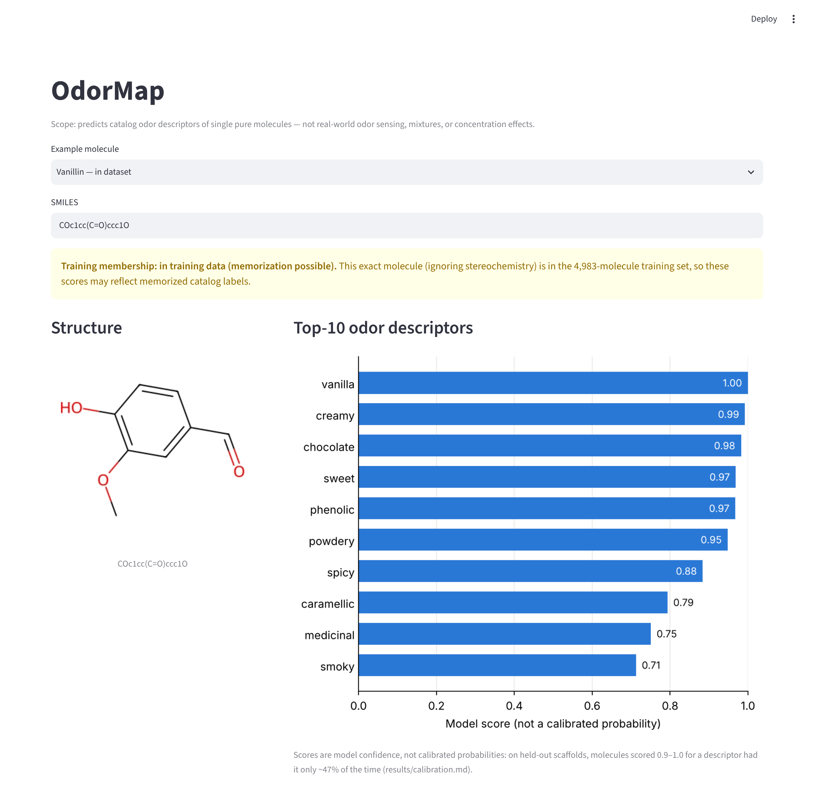
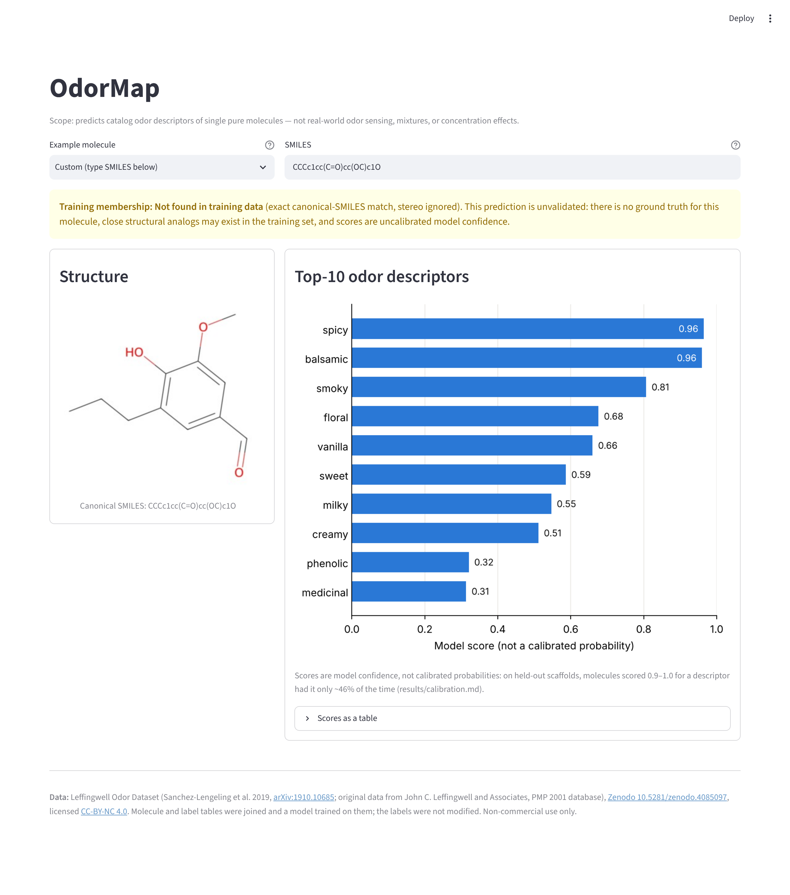

# OdorMap

Predicts **odor descriptors of single molecules** (e.g. "vanilla", "fruity",
"sulfurous") from their chemical structure (SMILES), trained on the
**Leffingwell Odor Dataset**: 3,522 molecules / 113 descriptors
(Sanchez-Lengeling et al. 2019; CC-BY-NC 4.0, **non-commercial use only** — see
[Attribution & license](#attribution--license)).

> **Scope:** this models catalog-style descriptor labels for individual pure
> molecules. It is **not** a model of real-world odor sensing: it knows nothing
> about mixtures, concentration, odor thresholds, individual perception, or
> electronic-nose / sensor data. The label set includes an `odorless` label, but
> it is one independent per-label score like the others, not an exclusive class,
> so the model returns descriptor scores for any valid molecule.

A CPU-only baseline (Morgan fingerprints + one-vs-rest logistic regression)
with a local Streamlit demo app.

> **Scores, not probabilities:** the numbers the model outputs are model
> confidence **scores**. They are **not calibrated probabilities**: on the
> held-out scaffold test set, pooled ECE is 0.104 and (molecule, descriptor)
> pairs scored 0.9–1.0 were positive only 46% of the time
> ([results/calibration.md](results/calibration.md)). Use them to rank
> descriptors, not as chances.

## Demo

```bash
pip install -r requirements.txt
python scripts/fetch_data.py && python scripts/run_baseline.py   # creates the model
streamlit run app.py
```

Runs locally on CPU; no paid APIs or GPU. If `models/baseline_lr.joblib` is
missing, `streamlit run app.py` on its own also works: the first run downloads
the dataset and trains the model (see [Deploy](#deploy-streamlit-community-cloud)).
Enter a SMILES
string or pick one of 8 example odorants (vanillin, cinnamaldehyde, limonene,
isoamyl acetate, linalool, eugenol, ethyl butyrate, benzaldehyde — all in the
Leffingwell set; type any other SMILES to see a molecule that is not). The app
shows the 2D structure, the top-10 descriptors with their scores, a **training
membership flag**, and the dataset attribution and license in its footer:

- **in training data (memorization possible)** — the saved model is refit on
  all 3,522 molecules, so for a dataset molecule the scores can reflect
  memorized catalog labels, not generalization;
- **Not found in training data** — not in the dataset (exact match on
  canonical SMILES, stereochemistry ignored). This does **not** demonstrate
  generalization: the prediction is unvalidated (there is no ground truth for
  this molecule), close structural analogs may exist in the training set, and
  scores are uncalibrated model confidence. Shown as a warning, like the
  in-training flag.

Vanillin (in the dataset):



5-Propylvanillin, a vanillin analog that is not in the dataset:



Screenshots are produced by `python scripts/screenshot_app.py` (needs
`pip install -r requirements-dev.txt` and `python -m playwright install chromium`,
or `CHROMIUM_PATH` pointing at an existing Chromium).

## Deploy (Streamlit Community Cloud)

The app is self-contained: neither the dataset nor the trained model is
committed (see [DATA.md](DATA.md)), so the app builds the model itself on first
start. The dataset is CC-BY-NC 4.0, so any deployment must be non-commercial.

1. On <https://share.streamlit.io>, create an app and connect this GitHub repository.
2. Set **Main file path** to `app.py`. Dependencies come from `requirements.txt`.
3. Deploy. The **first cold start** downloads the two dataset CSVs and trains the
   baseline (~1 minute; a "First run: downloading data and training baseline"
   spinner is shown). The model is cached for the life of the process; after the
   app sleeps or restarts, the next visit repeats this step.

**Runtime dependency:** the dataset is fetched at runtime from the pyrfume-data
mirror:

- <https://raw.githubusercontent.com/pyrfume/pyrfume-data/main/leffingwell/molecules.csv>
- <https://raw.githubusercontent.com/pyrfume/pyrfume-data/main/leffingwell/behavior.csv>

If either URL is unreachable (or a file moves), a fresh start cannot train the
model and the app shows an error naming the URLs instead of predictions.

## Setup

Python 3.10+; CPU only, no GPU or paid APIs.

```bash
pip install -r requirements.txt
```

## Fetch the data

The dataset is not stored in git (see [DATA.md](DATA.md) for provenance and
license). This downloads `molecules.csv` and `behavior.csv` from the pyrfume
mirror, joins them on `Stimulus = CID`, and saves `data/leffingwell.csv`.

```bash
python scripts/fetch_data.py
```

## Audit the data

```bash
python scripts/audit.py
```

Writes [results/audit.md](results/audit.md).

## Run the baseline

```bash
python scripts/run_baseline.py
```

Runs stratified random 5-fold CV (stereoisomers, which share a non-chiral
fingerprint, are kept in the same fold) and a Bemis-Murcko scaffold 80/20 split,
writes [results/baseline.md](results/baseline.md), and saves the model refit on
all data to `models/baseline_lr.joblib` (git-ignored). Takes well under a minute
on a laptop CPU.

## Results

From [results/baseline.md](results/baseline.md) and
[results/calibration.md](results/calibration.md):

| Split | macro ROC-AUC | micro ROC-AUC | macro F1@0.5 | mAP |
|---|---|---|---|---|
| Random 5-fold CV (mean ± sd) | 0.863 ± 0.003 | 0.911 ± 0.003 | 0.312 ± 0.008 | 0.326 ± 0.007 |
| Scaffold split (single split) | 0.756 | 0.844 | 0.162 | 0.169 |

**Caveats on the scaffold split:**

- The acyclic (empty) scaffold group — 1,821 molecules, **52% of the dataset** —
  is forced into the training set, so the scaffold **test set contains no acyclic
  molecules** and its distribution differs from the full dataset.
- It is a **single split (one seed)**, so the scaffold numbers carry **no
  variance estimate**.

**Calibration:** pooled ECE = 0.104 (10 bins, 20 labels with ≥ 30 test
positives, scaffold test set). Scores ≥ 0.5 are strongly over-confident, so
outputs are reported as scores, not probabilities.

**Low macro F1 and label frequency:** per-label F1@0.5 is moderately
rank-correlated with the label's number of test positives (Spearman ρ = 0.52;
ρ = 0.36 with train positives), while per-label ROC-AUC is not (ρ = −0.01).
Rare labels have lower F1 but are ranked about as well; the role of the fixed
0.5 threshold and of over-confident scores is a hypothesis that has not been
separated from rarity.

Calibration is measured with `python scripts/calibration.py`.

## Predict

```bash
python scripts/predict.py "COc1cc(C=O)ccc1O"
```

Prints the training-membership flag and the top-10 descriptors with their
scores (model confidence, not calibrated probabilities). Examples:
[results/predict_examples.md](results/predict_examples.md)
(regenerate with `python scripts/make_predict_examples.py`).

## Run tests

```bash
python -m pytest -q
```

Tests that need the dataset or the trained model are skipped if they are missing.

## Layout

```
app.py            Streamlit demo app
odormap/          library code: data loading, fetch, features, splits,
                  model/metrics, train (shared final-model training),
                  inference (membership flag), calibration
scripts/          fetch_data, audit, run_baseline, calibration, predict,
                  make_predict_examples, screenshot_app
tests/            pytest suite (incl. Streamlit AppTest tests)
results/          audit.md, baseline.md, calibration.md (+ reliability PNG),
                  predict_examples.md
docs/screenshots/ app screenshots used in this README
DATA.md           dataset provenance, license and attribution
```

## Attribution & license

The odor data is the **Leffingwell Odor Dataset**, canonical record on Zenodo,
DOI [10.5281/zenodo.4085097](https://doi.org/10.5281/zenodo.4085097),
downloaded from the pyrfume-data mirror. Please cite:

> Sanchez-Lengeling, B., Wei, J. N., Lee, B. K., Gerkin, R. C.,
> Aspuru-Guzik, A., & Wiltschko, A. B. (2019).
> *Machine Learning for Scent: Learning Generalizable Perceptual
> Representations of Small Molecules.* arXiv:1910.10685.
> <https://arxiv.org/abs/1910.10685>

Original data from **John C. Leffingwell and Associates**, PMP 2001 database.

The dataset is licensed under
[Creative Commons Attribution-NonCommercial 4.0 International (CC-BY-NC 4.0)](https://creativecommons.org/licenses/by-nc/4.0/).
Changes made: we joined the molecules and labels tables and trained models on
the result; the label data itself was not modified (details in
[DATA.md](DATA.md)).

**Non-commercial use only.** Because the dataset is CC-BY-NC 4.0, this demo,
its trained models and its predictions are for non-commercial use only.
