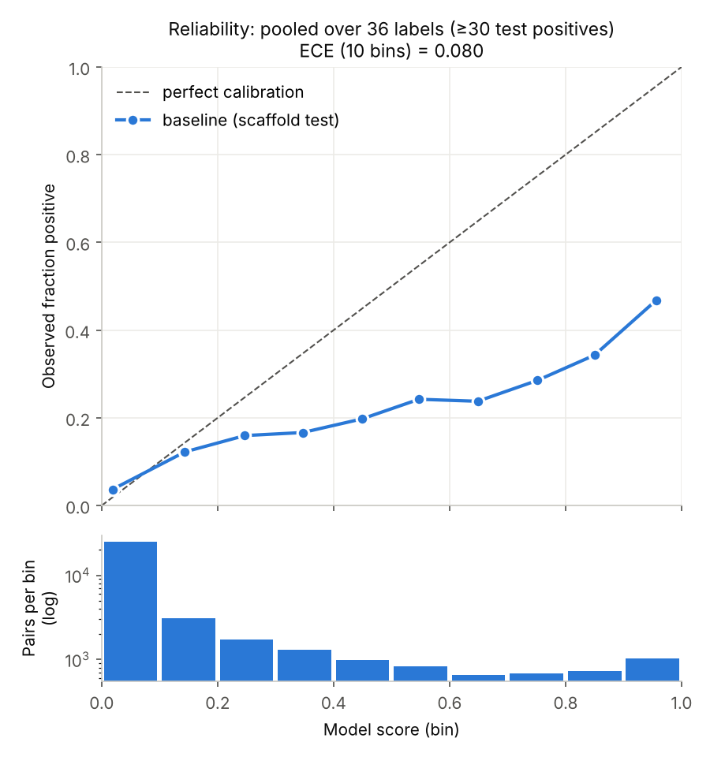

# Calibration of baseline scores (scaffold-split test set)

Generated by `python scripts/calibration.py` (seed=0). Model: same Morgan-fingerprint + one-vs-rest logistic regression (`class_weight='balanced'`) as `results/baseline.md`, fit on the scaffold-split train set (3986 molecules) and scored on the held-out scaffold test set (997 molecules, no acyclic molecules).

## Method

- Labels with ≥ 30 positives in the test set: **36 of 138**.
- Every (test molecule, label) pair for those labels is pooled: 35,892 pairs, 3,259 positive (base rate 0.091).
- 10 equal-width score bins on [0, 1]; ECE = Σ_b (n_b / N) · |observed positive fraction_b − mean score_b|.

## Result

| Quantity | Value |
|---|---|
| **ECE, pooled, labels with ≥ 30 test positives** | **0.080** |
| Mean score vs observed positive rate (same pairs) | 0.145 vs 0.091 |
| ECE, pooled over all 138 labels (context) | 0.036 |
| Per-label ECE, median [min, max] over the 36 labels (context) | 0.074 [0.014, 0.181] |

| Score bin | Pairs | Mean score | Observed fraction positive | Gap |
|---|---|---|---|---|
| [0.0, 0.1) | 24,923 | 0.019 | 0.037 | +0.018 |
| [0.1, 0.2) | 3,056 | 0.144 | 0.122 | -0.021 |
| [0.2, 0.3) | 1,717 | 0.247 | 0.160 | -0.087 |
| [0.3, 0.4) | 1,297 | 0.347 | 0.167 | -0.180 |
| [0.4, 0.5) | 986 | 0.449 | 0.198 | -0.252 |
| [0.5, 0.6) | 821 | 0.547 | 0.242 | -0.305 |
| [0.6, 0.7) | 656 | 0.648 | 0.238 | -0.411 |
| [0.7, 0.8) | 687 | 0.751 | 0.285 | -0.466 |
| [0.8, 0.9) | 723 | 0.850 | 0.343 | -0.507 |
| [0.9, 1.0] | 1,026 | 0.956 | 0.468 | -0.488 |

## Interpretation

- Measured pooled ECE is 0.080. That single number looks modest mainly because 69% of pairs fall in the lowest bin, where the gap is small. In 9 of 10 bins the mean score exceeds the observed positive fraction (negative gap = over-confident).
- Over-confidence grows with score: in bins with score ≥ 0.5 the gap ranges from -0.305 to -0.507. For example, pairs scored in [0.9, 1.0] are positive only 47% of the time.
- A likely contributor (hypothesis, not tested here) is `class_weight='balanced'`, which trains each label as if it had a 50/50 class prior; the model was not trained or post-processed to produce calibrated probabilities.
- **Verdict:** treat outputs as **ranking scores (model confidence)**, not calibrated probabilities. A score of 0.8 does **not** mean an 80% chance the descriptor applies. Ranking quality is measured separately by ROC-AUC / mAP in `results/baseline.md`.
- Caveats: single scaffold split (one seed), so no variance estimate; the test set has no acyclic molecules (the acyclic scaffold group is forced into train); the saved app/CLI model is refit on all data and its calibration on new molecules is not directly measured here.
